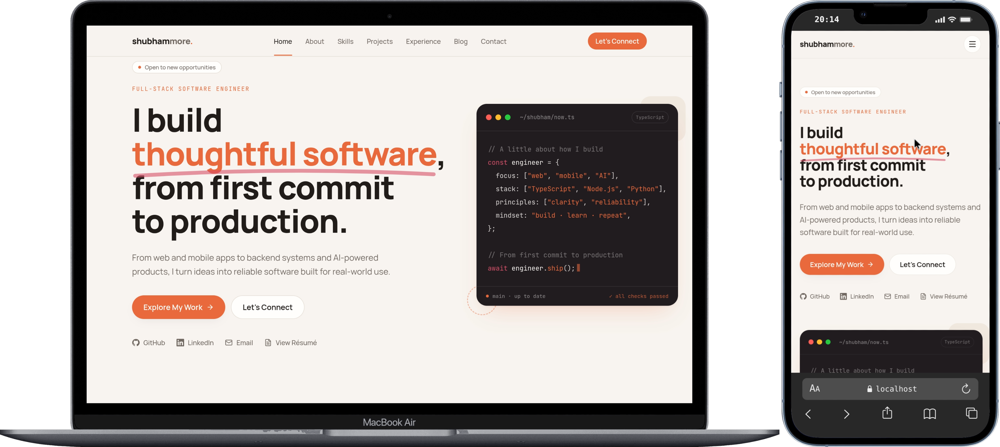

# Shubham More --- Portfolio

A personal portfolio showcasing my work as a software developer,
including selected projects, technical skills, professional experience,
and writing.



**Live website:** [shubhammoredev.com](https://shubhammoredev.com)

## About

This website brings together my development work, experience, and
technical interests in one place. It highlights projects I've built, the
technologies I work with, and the problems I've explored throughout my
software development journey.

## What's inside

-   **Introduction** --- an overview of who I am and what I do.
-   **Skills** --- technologies and tools I work with.
-   **Projects** --- selected work, with details about each project.
-   **Experience** --- professional background and development
    experience.
-   **Blog** --- articles and notes on technical topics.
-   **Contact** --- ways to get in touch.

## Built with

-   [Next.js](https://nextjs.org/)
-   React
-   TypeScript
-   Supabase
-   Tailwind CSS

## Run locally

Make sure Node.js and npm are installed.

``` bash
git clone <repository-url>
cd <repository-directory>
npm install
npm run dev
```

Open <http://localhost:3000> in your browser.

## Production build

``` bash
npm run build
npm run start
```
------------------------------------------------------------------------

Designed and developed by **Shubham More**.